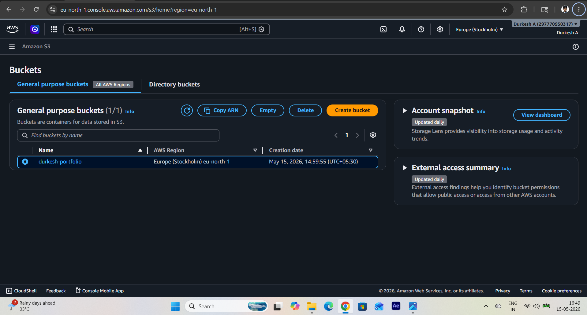
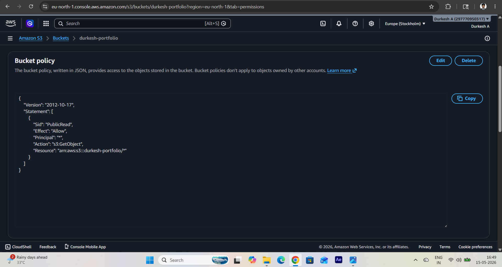
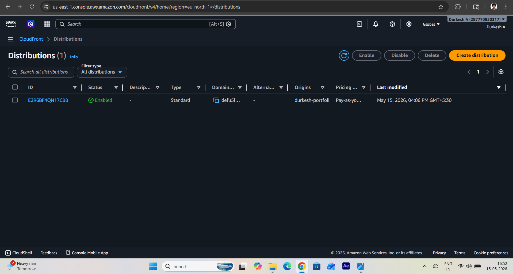

# 🌐 My Portfolio Website (AWS S3 + CloudFront)

## 📌 Project Overview
This project is a static portfolio website hosted on AWS.

## 🚀 Technologies Used
- HTML
- CSS
- AWS S3 (Static Hosting)
- AWS CloudFront (CDN + HTTPS)
- GitHub

## 🪜 Steps I Followed

1. Created a portfolio website using HTML and CSS
2. Uploaded project files to GitHub
3. Created an S3 bucket and uploaded files
4. Enabled static website hosting
5. Added bucket policy for public access
6. Created CloudFront distribution
7. Enabled HTTPS using CloudFront

## 🔗 Live Website
https://defu5lx17kg8.cloudfront.net

Note: These activities were completed as part of internship learning tasks. The AWS Free Tier trial has expired, and the associated AWS resources are currently inactive.

## 📂 GitHub Repository
https://github.com/Durkesh23/portfolio

## 📸 Screenshots

### S3 Bucket

### Bucket Policy

### CloudFront Distribution

## 👨‍💻 Author
Durkesh A
